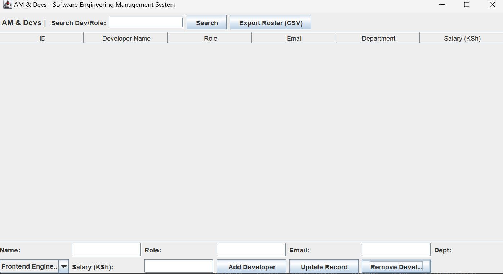

# AM & Devs — Software Engineering Management System

A desktop application built with Java Swing and SQLite for managing developer rosters and software teams at AM & Devs.



## Features
* **Developer Tracking:** Manage developer names, software roles, email addresses, departments, and salaries (in KSh).
* **Search & Filter:** Instantly filter developers by name, role, or department.
* **CSV Export:** Export team rosters directly to `am_and_devs_roster.csv`.
* **Input Validation:** Prevents invalid emails and non-numeric salary inputs.
* **Local SQLite Database:** Zero-configuration local database using `employees.db`.

## Requirements
* Java Development Kit (JDK) 8 or higher
* SQLite JDBC Driver (`lib/sqlite-jdbc.jar`)

## How to Run

1. **Clone the repository:**
   ```bash
   git clone [https://github.com/YOUR_USERNAME/EmployeeSystem.git](https://github.com/YOUR_USERNAME/EmployeeSystem.git)
   cd EmployeeSystem